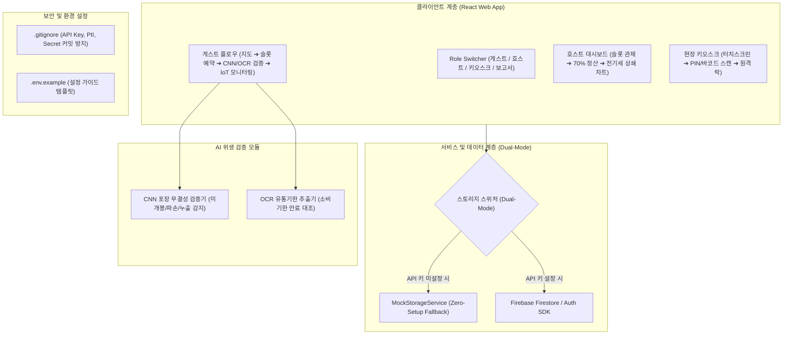

# [Implementation Plan] KeepIn Cool (킵인쿨) - 웹 프로토타입 구현 계획서

> **문서 상태**: 실행 준비 완료 (Ready for Execution)  
> **버전**: v1.0.0  
> **프로젝트 성격**: B2P 단기 신선·냉동 보관 중개 플랫폼 웹 프로토타입  

---

## 1. 아키텍처 및 기술 스택 개요

### 기술 스택 선정 근거
1. **Frontend**: React 18, Tailwind CSS, Lucide React, Chart.js
   - 모바일 퍼스트 반응형 레이아웃 및 심사위원 데모를 위한 즉각적 뷰 전환 지원.
2. **Data Layer (Dual-Mode)**:
   - `MockStorageService` + `Firebase Firestore` 양방향 아키텍처.
   - API 키가 없어도 브라우저 LocalStorage 기반으로 100% 동작하여 발표 현장의 네트워크/키 오류 원천 차단.
3. **AI Vision Module**:
   - CNN 포장 파손/미개봉 검증 모듈 + Tesseract/Regex 기반 유통기한 OCR 엔진.
   - 프로토타입 특성에 맞춰 실시간 카메라 입력 및 원클릭 프리셋(정상/파손/기한임박) 인터랙티브 지원.
4. **Security**:
   - `.gitignore` 표준 템플릿과 `.env.example`을 적용하여 GitHub 유출 제로(0%) 보장.

---

## 2. 단계별 세부 구현 로드맵 (Phased Execution)

### 📌 Phase 1: 보안 환경 및 기반 설정 (Security & Base Setup)
- [x] **Task 1.1**: `.gitignore` 작성
  - `.env`, `firebase-adminsdk*.json`, `serviceAccountKey.json`, `credentials.json`, `node_modules/`, `*.log` 차단.
- [x] **Task 1.2**: `.env.example` 템플릿 작성
  - Firebase 설정값(`VITE_FIREBASE_API_KEY`, etc.) 및 카카오맵 JS 키(`VITE_KAKAO_MAP_KEY`) 예시 제공.
- [x] **Task 1.3**: 공통 상단 네비게이션 `Navbar.jsx` (Role Switcher)
  - `[🚀 게스트 6단계 UX]` ↔ `[📊 호스트 점주 대시보드]` ↔ `[🖥️ 현장 키오스크]` ↔ `[📑 4단계 과제 보고서]` 원클릭 전환 보장.

---

### 📌 Phase 2: 데이터 계층 및 계약 구현 (Data Layer)
- [x] **Task 2.1**: 데이터 모델 타입 정의 (`types.js` 또는 `storageService.js`)
  - `Store`, `Slot`, `Booking`, `HygieneInspectionResult`, `Telemetry` 데이터 모델 규격화.
- [x] **Task 2.2**: Dual-Mode 스토리지 서비스 구현
  - `storageService.getStores()`, `getSlots(storeId)`, `createBooking()`, `getTelemetry(slotId)`, `getHostSettlement(storeId)`
  - Firebase 설정 여부를 감지하여 자동으로 Mock 데이터와 Firestore를 분기.

---

### 📌 Phase 3: 게스트 기능 1 - 지도 기반 탐색 및 슬롯 예약
- [x] **Task 3.1**: `KakaoStoreMap.jsx` 고도화
  - 카카오맵 SDK 동적 로드 + 키 미입력 시 인터랙티브 SVG/벡터 거점 맵 Fallback 엔진 탑재.
  - 신촌/홍대/안암 무인 매장 핀 표시, 실시간 잔여 슬롯(`4/12칸`), 현재 온도(`-19.2℃`), 도보 시간 표기.
- [x] **Task 3.2**: `SlotPicker.jsx` 슬롯 예약 및 안전 약관
  - 12개 슬롯 그리드 인터랙티브 선택 (A-01 ~ A-12).
  - 보관 기간(1~3일) 및 보관 품목 선택(미개봉 공산품).
  - **5대 현실화 안전장치 약관 동의 체크박스** 및 **투명 요금 분배 내역(점주 70% 2,100원 / 플랫폼 20% 600원 / 보험 10% 300원)** 실시간 렌더링.
- [x] **Task 3.3**: `MobilePassModal.jsx` 출입 패스 발급
  - 예약 고유 ID(`KIC-2026-X8841`), SVG QR 코드, 6자리 PIN 발급.

---

### 📌 Phase 4: 게스트 기능 2 - CNN 포장/유통기한 위생 검증 OCR
- [x] **Task 4.1**: `SealingVerifier.jsx` 위생 검증 AI 컴포넌트 개발
  - 웹캠 스트림 또는 파일 업로드 인터페이스 제공.
  - **CNN 포장 무결성 검증 엔진**:
    - 포장 밀봉 여부(Sealed/Unsealed), 비닐 찢어짐(Tear), 패키지 파손(Damage), 냉동 성에(Frost) 분석.
    - 무결성 신뢰도 점수(0~100%) 산출.
  - **OCR 유통기한 파싱 엔진**:
    - 날짜 패턴 추출(`YYYY.MM.DD`, `YY-MM-DD`, `EXP`) 및 만료 잔여일 대조.
    - 보관 만료일보다 잔여 유통기한이 짧을 경우 반려 사유 노출.
- [x] **Task 4.2**: 데모용 3대 인터랙티브 테스트 시나리오 프리셋 버튼
  - 버튼 ① `[✅ 정상 밀봉 만두 (Pass)]`: CNN 신뢰도 96%, 잔여 180일 ➔ 즉시 승인.
  - 버튼 ② `[❌ 포장 파손 냉동피자 (Fail)]`: CNN 파손 감지(비닐 찢김) ➔ 즉시 반려.
  - 버튼 ③ `[❌ 유통기한 경과 밀키트 (Fail)]`: OCR 어제 날짜 감지 ➔ 즉시 반려.

---

### 📌 Phase 5: 게스트 기능 3 - 실시간 IoT 온도 및 변색 스티커 확인
- [x] **Task 5.1**: `IotTelemetryView.jsx` 실시간 콜드체인 관제
  - Chart.js 연동: 2~3초 주기로 `-18.0℃ ~ -19.5℃` 정상 냉동 온도 실시간 갱신 그래프.
  - 남은 보관 시간 카운트다운 타이머.
- [x] **Task 5.2**: TTI 변색 스티커 상태 시각화
  - 정상 콜드체인 유지 상태: **안심 파란색 (Safe Blue)**.
  - 해동/고온 노출 상태: **영구 변색 적색 (Spoiled Red)**.
- [x] **Task 5.3**: 이상 온도 긴급 시뮬레이터 (Abnormal Alert Test)
  - `[⚠️ 이상 고온(-5℃) 시뮬레이션]` 버튼 클릭 시:
    - 차트 급상승, 경고 배너 점멸, 10만원 한도 단기 특약 보험 접수 절차 모달 시연.

---

### 📌 Phase 6: 호스트 기능 - 12슬롯 관리 및 70% 정산 대시보드
- [x] **Task 6.1**: `HostDashboard.jsx` 슬롯 관제 그리드
  - 12칸 냉동고 슬롯별 보관 고객, 품목명, 잔여 시간, 온도 상태 카드 뷰.
  - 특정 슬롯 점검 및 비상 개방 토글.
- [x] **Task 6.2**: 70% 수익 정산 및 전기세 상쇄 대시보드
  - 누적 정산금(예: 378,000원 = 180건 × 2,100원).
  - **전기세 상쇄 비교 차트**: 월 전기세(180,000원) vs 킵인쿨 보관 정산액(378,000원) 비교 바 차트.
  - `전기세 100% 전액 상쇄 + 순이익 +198,000원 달성` 강조.
  - 픽업 방문객 매장 상품 교차 구매율(`+14.2%`) 및 추가 예상 매출 카드.

---

### 📌 Phase 7: 보안 검증 및 데모 시연 준비
- [x] **Task 7.1**: Git 보안 감사
  - `.gitignore` 정상 등록 및 불필요한 캐시/비밀 키 파일 배제 확인.
- [x] **Task 7.2**: 통합 엔드투엔드(E2E) 시연 테스트
  - 게스트 예약 ➔ CNN/OCR 검증 ➔ IoT 온도 모니터링 ➔ 호스트 대시보드 70% 정산 반영 확인.

---

## 3. 검증 및 테스트 계획 (Verification Plan)

### 3.1 기능별 검증 시나리오
1. **지도 및 예약 검증**:
   - 카카오맵 키 유/무 환경 모두에서 거점 마커와 슬롯 수(`잔여 4/12칸`)가 정상 노출되는가?
   - 슬롯 선택 시 보관료(3,000원) 중 점주 몫(2,100원)이 명확히 표시되는가?
2. **CNN/OCR 위생 검증**:
   - 프리셋 버튼 클릭 시 각각 `Pass`, `포장 파손 반려`, `유통기한 경과 반려` 피드백이 시각적으로 명확한가?
3. **IoT 텔레메트리 & 변색 스티커**:
   - 실시간 그래프가 영하 18℃ 선을 유지하며 주기적으로 업데이트되는가?
   - 이상 고온 토글 시 보험 보상 프로세스가 정확히 트리거되는가?
4. **호스트 70% 정산**:
   - 누적 정산액과 냉동고 전기세(18만 원) 상쇄 비교 그래프가 명확히 렌더링되는가?
5. **보안 검증**:
   - `.gitignore`가 GitHub 푸시 시 민감 정보(`*.env`, `serviceAccountKey.json` 등)를 완벽히 차단하는가?
